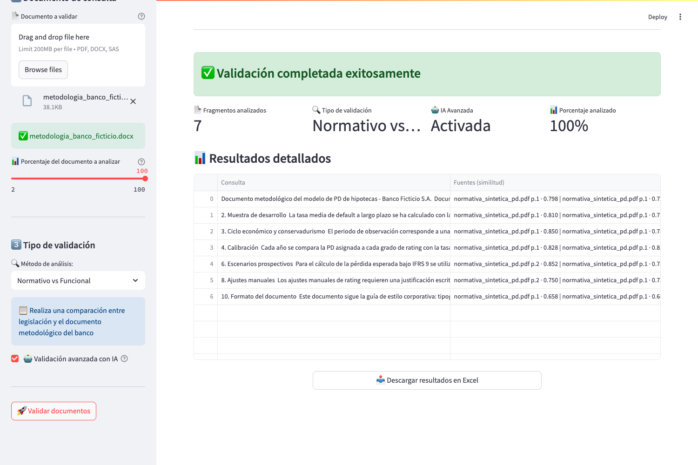
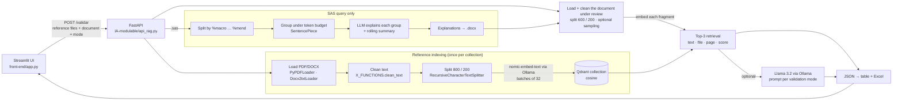

# Credit-Risk Model Documentation Validator (local RAG)

[](https://github.com/josee2202/credit-risk-rag-validator/actions/workflows/ci.yml)

Cross-checks credit-risk (PD) model documentation against regulation, and methodology against
implementation down to SAS code, **fragment by fragment**. For every fragment it returns the
supporting passages with **file, page and similarity score**, plus an optional verdict from a
local LLM. Everything runs on your machine (Ollama + Qdrant): no document leaves it.

**Who it is for:** model validation, internal audit and model-risk teams, and the consultants who
review IFRS 9 / IRB probability-of-default (PD) model documentation, where reading a 100-page
methodology document against the regulation and the code by hand is slow and error-prone.

**What this repository demonstrates**

- An end-to-end RAG pipeline: PDF/DOCX/SAS ingestion → cleaning and chunking → `nomic-embed-text`
  embeddings → Qdrant → top-3 evidence per fragment → optional Llama 3.2 verdict, served by a
  FastAPI backend and a Streamlit UI, with four validation modes.
- Traceable output: each fragment of the reviewed document comes back with its evidence, source
  file, page and cosine similarity, downloadable as Excel.
- A small, reproducible evaluation on a labelled synthetic corpus mixed with a real public
  regulation as distractors: retrieval puts the right requirement in the top 3 for 7 of the 8
  sections that have one, while **the default 1B local LLM labelled all 10 sections as aligned**,
  including 3 deliberate deviations. It is useful as an evidence finder, not as an automatic judge
  (see [Evaluation](#evaluation)).
- 20 automated tests and a CI pipeline that also runs the demo with real embeddings on GitHub Actions.

**Try it:** [Quick start](#quick-start) · demo outputs in [`examples/outputs/`](examples/outputs/) ·
evaluation report in [`eval/results/`](eval/results/README.md)



---

## Contents

[Use case](#use-case) · [Example](#example-output) · [Architecture](#architecture) ·
[Quick start](#quick-start) · [Configuration](#configuration) · [API](#api) ·
[Evaluation](#evaluation) · [Technical decisions](#technical-decisions) ·
[Limitations](#limitations-and-future-work) · [Tests and CI](#tests-and-ci) ·
[Project history](#project-history) · [Repository layout](#repository-layout) · [Data and licensing](#data-and-licensing)

## Use case

A bank's PD model is described by several documents that must stay consistent with each other and
with the regulation. The UI offers four validation modes. In each one, a *reference* set is indexed
and every fragment of the *document under review* is used as a query against it:

| Mode (UI label) | Reference (indexed) | Document under review | Question it helps answer |
|---|---|---|---|
| Normativo vs Funcional | Regulation (e.g. Banco de España Annex 9, EBA guidelines) | Methodology document | Which regulatory passage applies to this methodology paragraph, and is it met? |
| Funcional vs Técnico | Methodology document | Technical (implementation) document | Does the implementation description match the methodology? |
| Código vs Técnico | Technical document | SAS code | Does the code do what the technical document says? |
| Código vs Estadístico | Statistical-testing guidance | SAS code | Does the code implement the expected tests? |

SAS code is first split into macro blocks, grouped under a token budget and explained in plain
Spanish by the LLM, and that explanation is what gets compared.

The practical value is **coverage and traceability**: every paragraph of the reviewed document is
paired with the passages a reviewer should read, with the page to find them. The final judgement
stays with the reviewer.

## Example output

From [`examples/outputs/normativo_vs_funcional.md`](examples/outputs/normativo_vs_funcional.md)
(synthetic documents, `llama3.2:1b`). The methodology states three years of data while the guide
requires at least five:

> **Fragment under review** (methodology, section 2):
> *«La tasa media de default a largo plazo se ha calculado con la muestra disponible entre enero de
> 2021 y diciembre de 2023, es decir, tres años de observación. Los años anteriores se han descartado
> porque procedían de un sistema informático antiguo, sin que se haya documentado un análisis del
> impacto de esta exclusión.»*
>
> **Top evidence** · `normativa_sintetica_pd.pdf · p.1 · similarity 0.810`:
> *«R2. Profundidad histórica de los datos. La tasa media de default a largo plazo utilizada para
> calibrar la PD se calculará con un periodo de observación de al menos cinco años. […] Las
> exclusiones de periodos deberán justificarse y documentarse.»*
>
> **LLM verdict** (`llama3.2:1b`, excerpt):
> *«La tasa media de default a largo plazo se calcula con una muestra de desarrollo de tres años, lo
> cual es una práctica común en la industria financiera. Esto se alinea con la normativa R2.
> Profundidad histórica de los datos.»*

In short, the methodology uses 3 years of data and the rule requires at least 5. The model reads
the three years correctly and still concludes that they comply. In an earlier run of the same demo
it reached the same wrong verdict by misreading the sample as "at least five years".

The retrieval is right: the top passage contains requirement R2. The 1B model's verdict is
**wrong**, and this is the typical failure measured in the evaluation below.

## Architecture



Key modules: `RAG3.py` (loading, cleaning, chunking and query loop), `X_qderant.py` (embeddings in
batches, Qdrant storage and search), `Codigo_sas.py` (SAS processing), `X_AGENT.py` and `prompt.py`
(LLM agents and prompts), `config/` (settings).

## Quick start

Tested on macOS (Intel, CPU only) and Ubuntu (GitHub Actions) with Python 3.12.

**Prerequisites:** Python 3.12, [Ollama](https://ollama.com/download), and Docker for Qdrant
(optional, see below).

```bash
git clone https://github.com/josee2202/credit-risk-rag-validator.git
cd credit-risk-rag-validator
python3.12 -m venv .venv && source .venv/bin/activate
pip install -r requirements.txt

ollama pull nomic-embed-text      # embeddings (274 MB)
ollama pull llama3.2:1b           # LLM for SAS translation and verdicts (1.3 GB)

docker run -d --name rag-qdrant -p 6333:6333 \
  -v rag_qdrant_storage:/qdrant/storage qdrant/qdrant:v1.14.1
```

No Docker? Run Qdrant embedded in the API process instead by setting
`export QDRANT_LOCATION=./qdrant_storage` before starting the API.

Start the backend and the UI in two terminals:

```bash
# terminal 1 — API on http://localhost:8000
cd IA-modulable && uvicorn api_rag:app --port 8000

# terminal 2 — UI on http://localhost:8501
streamlit run front-end/app.py
```

In the UI, upload `examples/synthetic/normativa_sintetica_pd.pdf` as reference, create a
collection, upload `examples/synthetic/metodologia_banco_ficticio.docx` as the document to validate
and press **Validar documentos**.

Or run the scripted demo against the API, which regenerates `examples/outputs/`:

```bash
python examples/run_demo.py --sin-agente   # retrieval only for the text modes (~3 min on CPU, SAS modes still use the LLM)
python examples/run_demo.py                # all four modes with LLM verdicts (~11 min on CPU)
```

## Configuration

Defaults live in [`IA-modulable/config/config.yaml`](IA-modulable/config/config.yaml). Every value
can be overridden with an environment variable (see [`.env.example`](.env.example)). **No API keys
are needed.**

| Variable | Default | Purpose |
|---|---|---|
| `OLLAMA_HOST_NAME` / `OLLAMA_PORT` | `localhost` / `11434` | Ollama server |
| `EMBED_MODEL` | `nomic-embed-text` | Embedding model |
| `LLM_MODEL` | `llama3.2:1b` | LLM for SAS explanations and verdicts (e.g. `llama3.2:3b`) |
| `LLM_MAX_TOKENS` | `1024` | Cap on generated tokens per LLM answer (prevents runaway generation) |
| `QDRANT_LOCATION` | `http://localhost:6333` | Qdrant URL, a local path (embedded mode) or `:memory:` |
| `API_URL` | `http://localhost:8000` | Backend URL used by the Streamlit UI |

## API

`POST /validar` (multipart form):

| Field | Type | Description |
|---|---|---|
| `file_ref` | file, repeatable | Reference document(s), PDF or DOCX |
| `file_query` | file | Document under review: PDF, DOCX or SAS |
| `collection_name` | text | Qdrant collection. If it already contains vectors they are reused and the reference is **not** re-embedded |
| `tipo_validacion` | text | One of the four modes above |
| `usar_agente` | bool | Add an LLM verdict per fragment |
| `doc_sample_ratio` | float (0-1] | Analyse only the first fraction of the fragments |

```bash
curl -s -X POST localhost:8000/validar \
  -F file_ref=@examples/synthetic/normativa_sintetica_pd.pdf \
  -F file_query=@examples/synthetic/metodologia_banco_ficticio.docx \
  -F collection_name=demo_normativa -F tipo_validacion="Normativo vs Funcional" -F usar_agente=false
```

Response (abridged):

```json
{"resultados": [{
  "chunk": "2. Muestra de desarrollo\n\nLa tasa media de default a largo plazo se ha calculado con la muestra disponible entre enero de 2021 y diciembre de 2023, es decir, tres años de observación. …",
  "relevant_chunks": ["… R2. Profundidad histórica de los datos La tasa media de default a largo plazo … al menos cinco años …", "…", "…"],
  "sources": [{"filename": "normativa_sintetica_pd.pdf", "page": 1}, …],
  "scores": [0.81, 0.7149, 0.6733],
  "context": "Documento: normativa_sintetica_pd.pdf\n…"
}]}
```

With `usar_agente=true` each result also has `respuesta`. `GET /colecciones` lists the collections.
Input errors (unsupported format, no extractable text) return 400; Ollama or Qdrant failures return
500 with the cause.

## Evaluation

[`eval/run_eval.py`](eval/run_eval.py) regenerates the [report](eval/results/README.md). It needs
Ollama and Qdrant running, plus `python examples/public/download_anejo9.py` once.

**Data.** A synthetic, labelled corpus written for this repo
([`examples/synthetic_corpus.py`](examples/synthetic_corpus.py)):

- a 10-requirement "supervisory guide" on PD estimation;
- a fictitious bank's methodology with 10 sections: 5 aligned with a requirement, 3 with
  deliberate deviations (3 years of data instead of ≥5, no margin of conservatism, a single
  IFRS 9 scenario instead of ≥3) and 2 with no applicable requirement.

For retrieval, the guide is indexed alone and together with the **real Annex 9 of Banco de España
Circular 4/2017** (official BOE text, ~350 extra chunks acting as distractors).

**Method.**

- *Retrieval:* each methodology section is a query, top-3 by cosine similarity. A retrieved chunk is
  relevant if it contains ≥60% of the significant words of the labelled requirement. Metrics are
  Hit@1, Hit@3 and MRR@3 over the 8 sections with a requirement.
- *Insufficient evidence:* compare the top-1 similarity of the 2 sections without a requirement
  against the other 8.
- *LLM verdict:* the API's "Normativo vs Funcional" prompt with the retrieved context. Each answer
  is labelled aligned / not aligned / no evidence by reading it in full, with a one-line
  justification per answer, and cross-checked with a keyword heuristic. The full answers are saved.

**Results** (Intel Mac CPU, single run, temperature 0; LLM wording varies between runs):

*Retrieval* (8 sections with an applicable requirement):

| Reference collection | Chunks | Hit@1 | Hit@3 | MRR@3 | Indexing time |
|---|---:|---:|---:|---:|---:|
| Synthetic guide only | 6 | 8/8 | 8/8 | 1.00 | 2 s |
| Synthetic guide + real BOE Annex 9 | 355 | 7/8 | 7/8 | 0.88 | 99 s |

The miss is M8 (manual rating overrides). With the real regulation added, its top 3 are all Annex 9
passages about loan classification and real-estate collateral, which are not relevant.

*Insufficient evidence:* with the Annex 9 added, the top-1 similarity is 0.731–0.835 for the 8
sections with a requirement, and 0.683 and 0.721 for the 2 without one. The gap is 0.01, too thin
to set a reliable "no evidence" threshold.

*LLM verdict* (10 sections, context retrieved from the synthetic guide, manual review of every answer):

| Model | Correct | Said "aligned" for the 3 deviations + 2 sections with no requirement | Seconds per answer |
|---|---:|---:|---:|
| `llama3.2:1b` (default) | 5/10 | 5/5 | 55 |
| `llama3.2:3b` | 6/10 | 2/5 (plus 1 ambiguous) | 55 |

- The 1B model answered "aligned" for all 10 sections, so its 5 correct answers are exactly the 5
  aligned ones.
- The 3B model caught "3 years instead of ≥5" (M2). It still said a single IFRS 9 scenario "aligns"
  with a rule requiring at least three (M6).
- The keyword heuristic agrees with the manual review in 18 of 20 answers. Per-case labels, the
  justification for each and the full answers are in [`eval/results/`](eval/results/README.md).

**What this does and does not show.**

- With these synthetic sections, retrieval reliably surfaces the relevant requirement even among
  ~350 chunks of real regulation.
- The small local LLMs are not reliable judges of compliance: the 1B model labels every section as
  aligned, including the deliberate deviations and text with no applicable rule.
- The corpus is tiny (10 queries) and written to be clear-cut, so these numbers are a smoke test of
  the pipeline, **not** an estimate of accuracy on real bank documentation.
- There is no expert-labelled real-world benchmark here, and each verdict was labelled by a single
  reviewer (raw answers are included so anyone can re-check them).

**Real-world scale check (local only, not reproducible from this repo).** The pipeline was also run
on a private, real PD methodology document (~20,000 words) against the BOE Annex 9:

- indexing the 349 regulation chunks and validating all 295 fragments of the document took 169 s
  without the LLM, every fragment returning 3 traceable passages (top-1 similarity 0.67–0.80);
- with LLM verdicts, a 5% sample (14 fragments) took 567 s, about 40 s per fragment;
- a real 510-line SAS program (5 macro groups) was explained by the LLM and validated against a real
  technical document in 468 s (20% sample, 4 fragments). The first attempt hung because the 1B model
  looped (38,000 tokens in 2 h), which led to the `LLM_MAX_TOKENS` cap.

Only these aggregate figures are reported.

## Technical decisions

| Decision | Why | Alternatives and trade-off |
|---|---|---|
| **Fully local stack** (Ollama + Qdrant) | Model documentation is confidential; nothing leaves the machine and there is no per-token cost | Hosted LLM APIs would likely give better verdicts, at the price of data leaving the bank and a per-token cost |
| **Every fragment of the reviewed document is a query** | Guarantees coverage: every paragraph gets evidence, rather than answering only the questions someone thought to ask | Classic question-answering RAG; per-section summaries. Cost grows linearly with document length |
| **Qdrant with named, persistent collections**; reuse if not empty | A regulation is embedded once and reused across reviews | FAISS / in-memory stores were tried during development (`RAG1.py`, `pruebas_metodos/`). Risk: a stale collection is silently reused if the reference changes |
| **SAS → natural language → text comparison** | Methodology and technical documents describe intent in prose, so comparing prose with prose lines up better than embedding raw code | Embedding code directly, or parsing SAS. The LLM translation adds latency and can introduce errors (observed with the 1B model) |
| **Macro-aware SAS splitting + token-budget grouping + rolling summary** | Keeps whole macros together and gives the LLM context from earlier blocks | Fixed-size character chunks. The rolling summary grows with the program and can exceed the context window on long files |
| **Chunk sizes 800/200 (reference) and 600/200 (review)** | Chosen during the original development | Not re-tuned in this recovery |

## Limitations and future work

**Limitations**

- **Verdict quality:** the default `llama3.2:1b` is not a reliable judge (see Evaluation), and
  `llama3.2:3b` is also inconsistent. Treat verdicts as hints and the retrieved evidence as the
  output.
- **No "insufficient evidence" path:** top-3 passages are always returned, even when nothing
  relevant exists, and the prompt has no explicit "not applicable" outcome.
- **Sampling is not random:** `doc_sample_ratio` keeps the first X% of fragments, which can be just
  the table of contents.
- **Collection reuse by name:** uploading a different reference under an existing collection name
  silently reuses the old vectors.
- **CPU latency:** about 0.3 s per embedded chunk and ~55 s per LLM verdict on an Intel Mac CPU.
- **Not fully reproducible:** even at temperature 0, Ollama on CPU produced different wording across
  two runs of the same demo. Retrieval in the text modes was identical; the SAS modes changed
  because the LLM's explanation of the code, which is what gets compared, changed.
- **Capped LLM output:** answers stop at `LLM_MAX_TOKENS` (1,024 by default). This bounds latency but
  can cut off a long SAS explanation.
- **Not built for multiple users:** no authentication, one blocking request at a time, and a shared
  LLM agent whose prompt is set per request. Scanned PDFs are not OCR'd.
- **Legacy code:** the experiment scripts (`10_*`–`40_*`, `pruebas_metodos/`, `RAG1.py`, `RAG2.py`,
  `pipeline.py`) are kept as history. They point to private documents and are not maintained.

**Reasonable next steps**

- A similarity threshold and an explicit "not applicable / insufficient evidence" label.
- Structured JSON verdicts (aligned / not aligned / not applicable + quoted evidence).
- A larger model behind the existing `LLM_MODEL` switch, or a private hosted endpoint.
- `nomic-embed-text` task prefixes.
- Collection versioning by document hash.
- Random or stratified sampling.
- Background jobs for long documents.

## Tests and CI

| Where | What runs | External services |
|---|---|---|
| CI job `tests` | 20 pytest tests: cleaning, SAS splitting and grouping, Qdrant indexing/search (in-memory), API end to end, Streamlit UI (`AppTest`) and the LLM token cap, including regression tests for the recovery fixes | None: in-memory Qdrant and **test doubles** for embeddings and the LLM |
| CI job `demo-retrieval` | Installs Ollama, pulls `nomic-embed-text`, starts Qdrant and the API, runs `examples/run_demo.py --sin-agente` for both text modes and checks every fragment has 3 traceable passages | Real embeddings and Qdrant, no LLM |
| Local only | LLM verdicts, SAS translation, `eval/run_eval.py`, real-document runs | Ollama with `llama3.2:1b` / `3b` |

```bash
pip install -r requirements-dev.txt
pytest -q
```

## Project history

The project started in 2025 as a master's thesis (TFM) prototype by José Tuñón. The original code
covers the pipeline, the API, the Streamlit UI, the SAS processing and the prompts.

In October 2026 it was recovered and stabilised with the help of an AI coding assistant (Claude Code),
because the original code did not install or run as left.
The fixes are listed in the [recovery pull request](https://github.com/josee2202/credit-risk-rag-validator/pull/1) and in the commit history:

- an uninstallable dependency pin;
- embedding requests rejected by Ollama;
- unbounded LLM generation that hung the SAS flow on real code;
- errors silently turned into empty "successful" responses;
- only the first reference file being indexed;
- SAS rejected in one mode;
- two prompt mix-ups;
- a UI crash.

The tests, synthetic data, evaluation, CI and this documentation were also added then.

## Repository layout

```
IA-modulable/            backend: FastAPI app, RAG pipeline, Qdrant handler, SAS processing, prompts, config
  descargas/source.spm   SentencePiece tokenizer (Helsinki-NLP/opus-mt-es-en, Apache-2.0) for token budgets
  10_* … 40_*, pruebas_metodos/, RAG1.py, RAG2.py, pipeline.py   original experiments (legacy)
front-end/app.py         Streamlit UI
examples/                synthetic corpus + generator, demo script, demo outputs, BOE downloader
eval/                    evaluation script and results
tests/                   pytest suite
docs/                    screenshots and interview notes
```

## Data and licensing

- **Synthetic data:** everything in `examples/synthetic/` is fictitious and written for this repo.
- **Annex 9 (BOE-A-2017-14334):** the official regulatory text is downloaded from boe.es by a
  script and is not redistributed.
- **Third-party components:** listed in [THIRD_PARTY_NOTICES.md](THIRD_PARTY_NOTICES.md).
- **Private documents:** the bank documentation used during the original development is
  confidential and not part of this repository.

**License:** none chosen yet, so all rights are reserved by default. Contact the author before
reusing the code.
